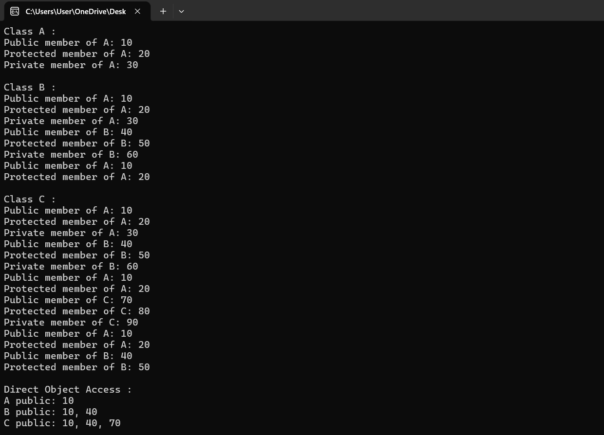
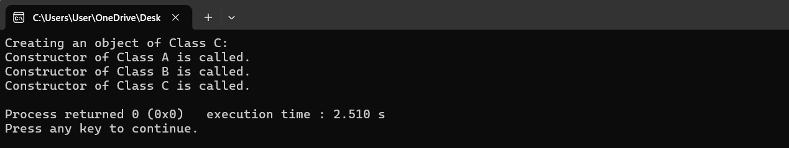
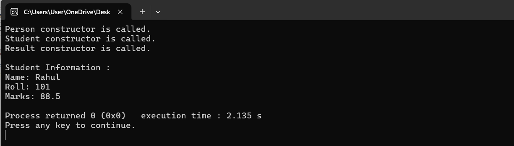

# Lab 03: 

| | |
| :--- | :--- |
| **Course** | ECE 1204 – Object Oriented Programming Sessional |
| **Lab Workout** | |
| **Submission Date** | |

---

## Table of Contents
1. [Problem-01](#problem-01)
2. [Problem-02](#problem-02)
3. [Problem-03](#problem-03)


---

## Problem-01
**Problem Statement:** Multilevel Inheritance with Access Specifiers.

Create a program to demonstrate multilevel inheritance involving at least three classes, where:
* Each class contains public, protected, and private data members.
* Use member functions to initialize and access these members.
* Try accessing the members through objects at different inheritance levels.

Your task is to:
1. Observe how access specifiers (public, protected, private) affect member visibility across derived classes.
2. Attempt to access all members from the base, intermediate, and derived class objects.
3. Match the access results with the accessibility table you studied in class.

**Status:** Done

### Code
```cpp
#include <iostream>
using namespace std;

class A
{
public:
    int a;

protected:
    int b;

private:
    int c;

public:
    void setA(int x, int y, int z)
    {
        a = x;
        b = y;
        c = z;
    }

    void showA()
    {
        cout << "Public member of A: " << a << endl;
        cout << "Protected member of A: " << b << endl;
        cout << "Private member of A: " << c << endl;
    }
};

class B : public A
{
public:
    int d;

protected:
    int e;

private:
    int f;

public:
    void setB(int x, int y, int z)
    {
        d = x;
        e = y;
        f = z;
    }

    void showB()
    {
        cout << "Public member of B: " << d << endl;
        cout << "Protected member of B: " << e << endl;
        cout << "Private member of B: " << f << endl;

        cout << "Public member of A: " << a << endl;
        cout << "Protected member of A: " << b << endl;
    }
};

class C : public B
{
public:
    int g;

protected:
    int h;

private:
    int i;

public:
    void setC(int x, int y, int z)
    {
        g = x;
        h = y;
        i = z;
    }

    void showC()
    {
        cout << "Public member of C: " << g << endl;
        cout << "Protected member of C: " << h << endl;
        cout << "Private member of C: " << i << endl;

        cout << "Public member of A: " << a << endl;
        cout << "Protected member of A: " << b << endl;

        cout << "Public member of B: " << d << endl;
        cout << "Protected member of B: " << e << endl;
    }
};

int main()
{
    A objA;
    B objB;
    C objC;

    objA.setA(10, 20, 30);
    objB.setA(10, 20, 30);
    objB.setB(40, 50, 60);

    objC.setA(10, 20, 30);
    objC.setB(40, 50, 60);
    objC.setC(70, 80, 90);

    cout << "Class A :" << endl;
    objA.showA();

    cout << "\nClass B :" << endl;
    objB.showA();
    objB.showB();

    cout << "\nClass C :" << endl;
    objC.showA();
    objC.showB();
    objC.showC();

    cout << "\nDirect Object Access :" << endl;

    cout << "A public: " << objA.a << endl;
    cout << "B public: " << objB.a << ", " << objB.d << endl;
    cout << "C public: " << objC.a << ", " << objC.d
         << ", " << objC.g << endl;

    return 0;
}
```

### Output



### Discussion

---

## Problem-02

**Problem Statement:** Constructors in Multilevel Inheritance & Hybrid Inheritance.

Create a multilevel inheritance example with constructors defined in each class of the hierarchy. Your task:
1. Define constructors in the base class, intermediate class, and derived class.
2. Use these constructors to display which class’s constructor is being called and in what order.
3. Show how constructors behave when an object of the most derived class (the class at the bottom of the inheritance chain) is instantiated.

**Status:** Done

### Code
```cpp
#include <iostream>
using namespace std;

class A
{
public:
    A()
    {
        cout << "Constructor of Class A is called." << endl;
    }
};

class B : public A
{
public:
    B()
    {
        cout << "Constructor of Class B is called." << endl;
    }
};

class C : public B
{
public:
    C()
    {
        cout << "Constructor of Class C is called." << endl;
    }
};

int main()
{

    cout << "Creating an object of Class C:" << endl;

    C obj;

    return 0;
}
```

### Output



### Discussion

---

## Problem-03

**Problem Statement:** Use a small real life scenario to implement this.

**Status:** Done

### Code
```cpp
#include <iostream>
#include <string>
using namespace std;

class Person 
{
public:
    string name;

    Person() 
    {
        cout << "Person constructor is called." << endl;
    }
};

class Student : public Person 
{
public:
    int roll;

    Student() 
    {
        cout << "Student constructor is called." << endl;
    }
};

class Result : public Student 
{
public:
    float marks;

    Result() 
    {
        cout << "Result constructor is called." << endl;
    }

    void display() 
    {
        name = "Rahul";
        roll = 101;
        marks = 88.5;

        cout << "\nStudent Information :" << endl;
        cout << "Name: " << name << endl;
        cout << "Roll: " << roll << endl;
        cout << "Marks: " << marks << endl;
    }
};

int main() 
{
    Result obj;
    obj.display();
    return 0;
}
```

### Output



### Discussion

---
