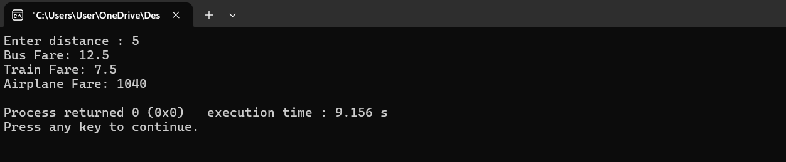

# Lab 03: 

| | |
| :--- | :--- |
| **Course** | ECE 1204 – Object Oriented Programming Sessional |
| **Lab Workout** | |
| **Submission Date** | |

---

## Table of Contents
1. [Problem-01](#problem-01)
2. [Problem-02](#problem-02)
3. [Problem-03](#problem-03)
4. [Problem-04](#problem-04)
5. [Problem-05](#problem-05)


---

## Problem-01
**Problem Statement:** Write a C++ program to implement a class called Shape with virtual member functions for calculating area and perimeter. Derive classes such as Circle, Rectangle, and Triangle from the Shape class and override virtual functions accordingly.

**Status:** Done

### Code
```cpp
#include <iostream>
#include <cmath>
using namespace std;

class Shape
{
public:
    virtual float area()
    {
        return 0;
    }
    virtual float perimeter()
    {
        return 0;
    }
};

class Circle : public Shape
{
    float r;
public:
    Circle(float rad)
    {
        r = rad;
    }
    float area()
    {
        return 3.1416 * r * r;
    }
    float perimeter()
    {
        return 2 * 3.1416 * r;
    }
};

class Rectangle : public Shape
{
    float l, w;
public:
    Rectangle(float len, float wid)
    {
        l = len;
        w = wid;
    }
    float area()
    {
        return l * w;
    }
    float perimeter()
    {
        return 2 * (l + w);
    }
};

int main()
{
    Shape *ptr;

    float r, l, w;

    Circle cir(5);
    ptr = &cir;
    cout << "Circle Area: " << ptr->area() << endl;
    cout << "Circle Perimeter: " << ptr->perimeter() << endl << endl;

    Rectangle rec(5, 4);
    ptr = &rec;
    cout << "Rectangle Area: " << ptr->area() << endl;
    cout << "Rectangle Perimeter: " << ptr->perimeter() << endl << endl;

    return 0;
}
```

### Output


### Discussion


---

## Problem-02
**Problem Statement:** Write a C++ program to implement a class called Student that has private member variables for name, class, roll number, and marks. Include member functions to calculate the grade based on the marks and display the student's information.

**Status:** Done

### Code
```cpp
#include <iostream>
#include <string>
using namespace std;

class Student
{
private:
    string name;
    string studentClass;
    int roll;
    double marks;

public:
    Student(string n, string c, int r, double m)
    {
        name = n;
        studentClass = c;
        roll = r;
        marks = m;
    }

    string calculateGrade()
    {
        if (marks >= 80)
            return "A+";
        else if (marks >= 70)
            return "A";
        else if (marks >= 60)
            return "A-";
        else if (marks >= 50)
            return "B";
        else if (marks >= 40)
            return "C";
        else
            return "F";
    }

    void display()
    {
        cout << "\nStudent Information:" << endl;
        cout << "Name: " << name << endl;
        cout << "Class: " << studentClass << endl;
        cout << "Roll Number: " << roll << endl;
        cout << "Marks: " << marks << endl;
        cout << "Grade: " << calculateGrade() << endl;
    }
};

int main()
{
    string name, cls;
    int roll;
    double marks;

    cout << "Enter student name: ";
    getline(cin, name);
    cout << "Enter class: ";
    getline(cin, cls);
    cout << "Enter roll number: ";
    cin >> roll;
    cout << "Enter marks: ";
    cin >> marks;

    Student s(name, cls, roll, marks);
    s.display();

    return 0;
}
```

### Output


### Discussion


---

## Problem-03
**Problem Statement:** Write a C++ program using an abstract class Transport with a pure virtual function fare(). Implement it in derived classes Bus, Train and Airplane.

**Status:** Done

### Code
```cpp
#include <iostream>
using namespace std;

class Transport
{
protected:
    double dist;
public:
    Transport(double d)
    {
        dist = d;
    }
    virtual double fare() = 0;
};

class Bus : public Transport
{
public:
    Bus(double d) : Transport(d) {}
    double fare()
    {
        return dist * 2.5;
    }
};

class Train : public Transport
{
public:
    Train(double d) : Transport(d) {}
    double fare()
    {
        return dist * 1.5;
    }
};

class Airplane : public Transport
{
public:
    Airplane(double d) : Transport(d) {}
    double fare()
    {
        return 1000 + dist * 8;
    }
};

int main()
{
    Transport *t;
    double d;

    cout << "Enter distance : ";
    cin >> d;

    Bus b(d);
    Train tr(d);
    Airplane a(d);

    t = &b;
    cout << "Bus Fare: " << t->fare() << endl;

    t = &tr;
    cout << "Train Fare: " << t->fare() << endl;

    t = &a;
    cout << "Airplane Fare: " << t->fare() << endl;

    return 0;
}
```

### Output



### Discussion


---

## Problem-04
**Problem Statement:** Create an abstract class Vehicle with a pure virtual function start().
Create a derived class Car without overriding start().
Create another derived class ElectricCar that overrides start().Try creating objects of both Car and ElectricCar.Identify which class is abstract.

**Status:** Done

### Code
```cpp
#include <iostream>
using namespace std;

class Vehicle
{
public:
    virtual void start() = 0;
};

class Car : public Vehicle
{
public:
    void info()
    {
        cout << "This is a car." << endl;
    }
};

class ElectricCar : public Vehicle
{
public:
    void start()
    {
        cout << "Electric car started silently." << endl;
    }
};

int main()
{
    // Car c;

    ElectricCar ec;
    ec.start();

    return 0;
}
```

### Output


### Discussion


---

## Problem-05
**Problem Statement:** 

**Status:** Done

### Code
```cpp

```

### Output


### Discussion


---
